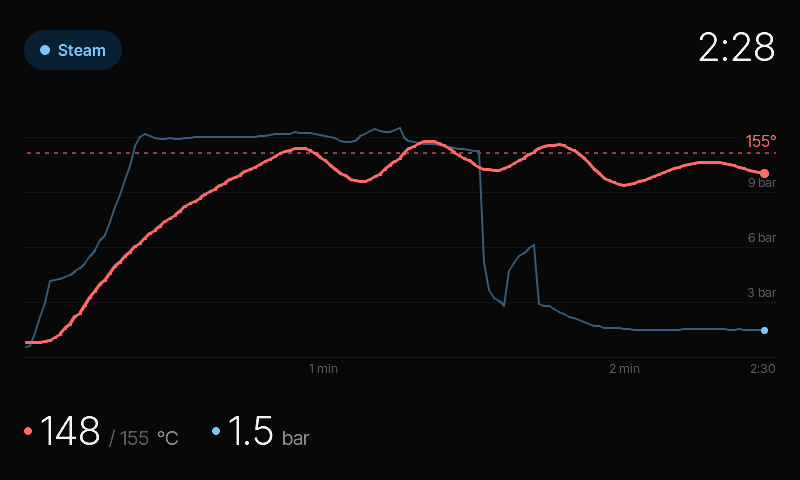

# Brewdeck

**Unofficial Wi-Fi screen for Gaggiuino machines.**

[](https://github.com/pongells/brewdeck/actions/workflows/ci.yml)
[License: PolyForm Noncommercial 1.0.0](#license) · [Web demo](https://pongells.github.io/brewdeck/) ·
[User manual](docs/manual.md)

Brewdeck is an unofficial touchscreen for everyday brewing on a [Gaggiuino](https://gaggiuino.github.io/)-modded
espresso machine, talking to it over Wi-Fi. It shows the machine at a glance, draws every shot live, lets you review it
against the profile or your previous shot, and handles the everyday controls: profile, brew temperature, stop weight,
flushing.
Use it on a [headless](https://gaggiuino.github.io/#/guides/interface-headless) machine or with the built-in screen
tucked away; everything else (editing profiles, settings, maintenance) stays in the machine's web UI.

**Try it** in the [web demo](https://pongells.github.io/brewdeck/) (no hardware, a recorded machine). **You need** a
spare 4.3" ESP32 touchscreen (the Guition JC4880P443 or a Sunton ESP32-8048S043-style board, see [Hardware](#hardware))
and a Mac or Linux computer to flash it ([Installing](#installing)).

It is also a base for your own screens and interfaces on Gaggiuino's network API. Wi-Fi, finding the machine, live
data, shots and the few commands live in a core behind one C header, so a new interface (any graphics library) or
another screen does not touch the network code ([Your own interface](#your-own-interface)).

The machine's built-in screen does not take custom firmware, so Brewdeck takes the other route: it is a separate
screen on the same network, using the machine's documented network API (REST and the WebSocket the official web UI
uses). Nothing on the machine is rewired or reflashed; the changes you make on Brewdeck (profile, brew temperature, stop
weight) are saved on the machine, as the web UI saves them.

> **Brewdeck is not an official Gaggiuino project** and is not affiliated with or endorsed by the Gaggiuino team.
> It works with Gaggiuino machines; all machine logic, safety and control stay in Gaggiuino's own firmware. Please
> report Brewdeck problems here, not to the Gaggiuino team.

<p>
  
  
  
  
</p>

## Features

A tour of every screen, with animations: **[User manual](docs/manual.md)**.

- **Ready at a glance**: boiler temperature and state (warming up, heating, ready, cooling), the active profile with a
  preview of its pressure and flow curve, pressure / scale / water status, and a warning while pressure is left in the
  system.
- **Everyday controls**: pick a profile, set brew temperature and stop weight (+/- or a keypad). Changes are saved on
  the machine, and each profile keeps its original values on the screen, so **Reset** brings them back.
- **Live shots**: pressure, flow, weight and temperature drawn as the shot runs, with the profile's targets dashed.
- **Shot review**: scrub through the finished shot and compare it with the profile's targets or your previous shot of
  the same profile. The machine's stored shots are one tap away in **Shot history**.
- **Steam**: boiler temperature against the steam set point, with pressure, from the moment steam is switched on.
- **Flush**: tap for flush mode, hold for the machine's timed flush.
- **Machine notices**: the machine's notifications as banners and in a list; an edge glow warns before the machine
  releases pressure.
- **Standby**: a dimmed clock after a while (optionally bouncing around), and the screen switches itself off when
  it has been unused for a long time or the machine is switched off.
- **Setup on the screen**: join Wi-Fi with the on-screen keyboard; find the machine by name (mDNS) or IP. If something
  is wrong, the screen says what (Wi-Fi out of range, wrong password, machine not answering) and offers the fix.

## What Brewdeck sends to the machine

Brewdeck mostly reads. It sends only these commands, from Gaggiuino's documented REST and WebSocket APIs, and only while
the machine is idle on its home screen (to end a flush, while flushing; never during a shot, steam or hot water):

| Action on the screen | Sent to the machine |
|---|---|
| Pick a profile | `POST /api/profile-select/<id>`, then `c_save_act_prof` (makes it the boot profile) |
| Brew temperature, stop weight | `c_upd_act_prof` with only that field changed, then `c_save_act_prof` |
| Flush button | `c_opmode` FLUSH / FLUSH_AUTO / back to HOME |
| Tare (hidden by default) | `c_tare_pend` |

A flush runs the machine's own flush mode, as the web UI does: the machine then runs the pump (the brew switch in
FLUSH, a timed flush in FLUSH_AUTO). Nothing else: no brewing, steam, descaling or calibration commands, no direct
control of the pump, valves or heater, and never a delete.

## Hardware

> **Brewdeck needs its own screen.** Do not flash the screen fitted to your machine: on a Gaggiuino Gen 3 machine that
> screen also runs the machine's Wi-Fi, web UI and network API, which Brewdeck itself needs. Use a spare screen.

- **Screen**: one of two tested 4.3" touchscreens, both powered over USB-C:
  - a Sunton ESP32-8048S043-style 800x480 RGB panel with an ESP32-S3 (16 MB flash, 8 MB PSRAM) and GT911 capacitive
    touch. Pins and timings: [`firmware/src/board/s3/board.h`](firmware/src/board/s3/board.h).
  - the Guition JC4880P443 with an ESP32-P4, see [below](#esp32-p4-board).
- **Machine**: a Gaggiuino machine with its Wi-Fi web UI, on the same 2.4 GHz network as the screen. Tested with one
  machine (Gaggiuino core 8aaf6f0 on an STM32U585 board, release c929939: fine on the machine; only a *spare screen*
  that received that update is locked, see below); a Gaggiuino update can change the protocol.
  Brewdeck keeps one of the machine's three WebSocket connections open and shows up to 24 profiles.

**The Sunton was tested on one unit only**: a spare Gaggiuino Gen 3 screen (the Sunton hardware above) that had not yet
received Gaggiuino's update [v.8aaf6f0](https://github.com/Zer0-bit/gaggiuino/releases/tag/main-8aaf6f0). That update
locks the Gen 3 screen it runs on (it migrates the partitions and sets eFuses), so a screen that has had it cannot take
other firmware; the Gen 3.5 screen is locked too. The same Sunton model bought on its own should work (the flash script
then writes it plainly), but that is untested: if you try one, please say how it went in the
[discussions](https://github.com/pongells/brewdeck/discussions).

## Installing

For the Sunton ESP32-S3 screen; the P4 board is [below](#esp32-p4-board). You need
[esptool](https://github.com/espressif/esptool) v5 (`brew install esptool` or `pip install esptool`; esptool 4.x spells
the commands `read_flash` / `write_flash`) and bash (macOS, Linux; on Windows untested, WSL may work). The serial port
is `/dev/cu.usbserial-…` on macOS, `/dev/ttyUSB0` or similar on Linux: to find it, list `ls /dev/cu.*` (Linux:
`ls /dev/tty*`) before and after plugging the screen in; the new entry is the screen.

**1. Check the screen** (reads only, writes nothing). "Flash Encryption: Enabled" is a Gaggiuino Gen 3 screen,
"Disabled" a plain board; "Secure download mode" means it is locked and cannot take other firmware.

```sh
esptool --port /dev/cu.usbserial-XXXX get-security-info
```

**2. Download a release.** Download `brewdeck-<version>-esp32s3.zip` from
[Releases](https://github.com/pongells/brewdeck/releases), unzip it and open a terminal in its folder
(`cd brewdeck-<version>-esp32s3`). The next steps run there.

**3. Back up its flash** (the whole 16 MB), into that folder's `backup/`, where `flash.sh` looks for it. It is the only
way back to the original firmware: keep a copy somewhere safe too.

```sh
mkdir -p backup
esptool --port /dev/cu.usbserial-XXXX --baud 460800 read-flash 0 0x1000000 backup/gaggiuino-screen-backup.bin
ls -l backup/gaggiuino-screen-backup.bin    # must be exactly 16777216 bytes
```

**4. Flash it** (a backup kept elsewhere: point `GAGGI_BACKUP` at it):

```sh
PORT=/dev/cu.usbserial-XXXX ./flash.sh
```

`flash.sh` checks the images against their checksums, asks the chip before writing, and never guesses (a wrong choice
would leave the screen unbootable):
- **Encrypted** (a Gaggiuino Gen 3 screen): it writes with `--encrypt` and refuses to run without the 16 MB backup.
- **Plain** (a Sunton board bought on its own): a plain write. It also wants a backup; `NO_BACKUP=1` flashes without
  one (accepted only for a plain board).
- **Locked** (secure download mode) or no answer: it stops without writing anything.

`FLASH_ENC=encrypted` or `plain` states what you expect (the script stops if the chip disagrees); `DRY_RUN=1` shows
the decision and the esptool command without writing. If esptool cannot connect, hold BOOT, tap RST, release BOOT. The
screen restarts by itself after flashing; if the picture looks wrong (stripes, shifted or frozen), unplug and replug
USB.

**5. Set it up on the screen.** It starts on "No Wi-Fi set up": choose your network and type the password. It then
looks for the machine as `gaggiuino.local`; another name or an IP can be set under Menu > Wi-Fi (tap the connected
network, then Machine).

**Updating**: download the new release and flash it the same way (step 4, with your backup). The backup stays valid,
and the screen keeps its Wi-Fi, machine address and settings.

**Back to the original firmware**: check the backup's size again (a short file would leave the screen unbootable), then
write it back as it is, **without** `--encrypt` (a Gen 3 backup already holds the encrypted contents):

```sh
esptool --port /dev/cu.usbserial-XXXX --baud 460800 write-flash 0x0 backup/gaggiuino-screen-backup.bin
```

### ESP32-P4 board

The Guition JC4880P443 (ESP32-P4, 4.3" 480x800 MIPI-DSI panel shown in landscape, Wi-Fi through an ESP32-C6) is a
retail board with no flash encryption. It runs every screen live from the machine, through shots (brewing, review,
previous shot, history) and steam. **Fit a 2.4 GHz antenna** (step 4 below): without one its Wi-Fi is weak. Use the
USB-C socket that carries data (on our board the top one, marked D4D5; the other one only powers it). Each release has
a package for it, `brewdeck-<version>-esp32p4.zip`: follow its INSTALL.txt. Or build it (next section), from
`firmware/`:

1. Back up its flash (also 16 MB) as in step 3, to `backup/p4-guition-original.bin` at the repository root, where
   `build.sh` looks for it (or point `GAGGI_BACKUP` at it; a plain board
   can also be flashed without one, `NO_BACKUP=1`). Its port is `/dev/cu.usbmodem…` on macOS, `/dev/ttyACM0` on Linux.
2. `./build.sh ui-p4 --flash`, then join Wi-Fi on the screen. On the network it is `brewdeck-p4`.
3. Update the board's ESP32-C6 (its Wi-Fi chip) once, to the ESP-Hosted version the firmware uses: boards ship with
   older C6 firmware (with very old versions the first Wi-Fi join drops at every start).
   `./build.sh p4-c6-update --flash` builds the C6 firmware from `firmware/c6` and installs it over the board's own
   link to the C6 (no network needed; the C6 boots it only when it arrived complete; progress in the
   [serial log](docs/development.md#serial-log)), then flash `ui-p4` again.
4. Fit an antenna. The board's Wi-Fi (the ESP32-C6) is wired to the small IPEX Gen3 (MHF3) socket on the module, next
   to its shield: without an antenna it still joins, but weakly. On our board, by the machine: about -83 dBm without
   one, -60 dBm with a 3 cm flexible 2.4 GHz antenna stuck inside the case, away from the board's metal. Plug it in
   only with the board unpowered, and press it straight on.

Pins: [`firmware/src/board/p4/board.h`](firmware/src/board/p4/board.h).

## Building

To build it yourself instead of using a release. The build uses
[pioarduino](https://github.com/pioarduino/platform-espressif32) (PlatformIO). Each board is a plain ESP-IDF project,
compiled from source with the settings in `firmware/sdkconfig.base.<chip>` and `firmware/sdkconfig.brewdeck.<chip>` (on
the S3: code and data run from PSRAM, cache line 64 B, an IRAM-safe panel interrupt, which keeps the picture steady
while Wi-Fi is busy).

You need [uv](https://docs.astral.sh/uv/) (the script runs PlatformIO through `uvx --python 3.14`; pioarduino does
not support newer Python yet), git and esptool. The first build downloads the toolchain and compiles everything
(several minutes); later builds take about 30 s. If PlatformIO then complains that its own `pioarduino` package is too
old (`6.2.0.post1` does not satisfy `>=6.2.0`), pin it:
`uv pip install --python ~/.platformio-brewdeck/penv/bin/python pioarduino==6.2.0`.

Make the backup first (step 3 above, into `backup/` at the repository root), then:

```sh
cd firmware
./build.sh ui            # the first run creates include/wifi_config.h (see below)
./build.sh ui --flash    # build, then flash with flash.sh (env PORT=..., GAGGI_BACKUP=path to the backup)
```

`build.sh --flash` runs the same `flash.sh` as a release, on the build's images. Never flash with
`pio run -t upload`: it skips all these checks. `include/wifi_config.h` (git-ignored) can hold your Wi-Fi network and
the machine's name or IP; left as created, the screen starts on "No Wi-Fi set up" and you choose the network there.
Other envs (debug builds, the P4, the touch test) and the debug tools: [development](docs/development.md). A release
package is made with `tools/make-release.sh <version> [s3|p4]` (CI makes both for each `v*` tag; notes from
[CHANGELOG.md](CHANGELOG.md)).

## Without hardware

The emulator runs the real UI code in a desktop window against a fake machine that plays a recorded shot and steam
session (`sim/build-emu.sh && sim/emu`, needs SDL2). The same runs in a browser as the
[web demo](https://pongells.github.io/brewdeck/). Tests, renders and the other tools: [development](docs/development.md).

## Your own interface

A UI is built on the core's API and compiled with it into one image; it can live in its own repository, pinned to a
Brewdeck release. Start from the [UI template](https://github.com/pongells/brewdeck-ui-template) and the
[custom UI guide](docs/custom-ui.md). Ideas, ports and interfaces of your own are welcome in the
[discussions](https://github.com/pongells/brewdeck/discussions).

For an idea of how far that goes, [Ledger](https://github.com/pongells/brewdeck-ui-ledger) is a whole different UI on
the same core: light and printed-looking, sharing no code or look with Brewdeck's own.

<a href="https://github.com/pongells/brewdeck-ui-ledger"></a>

## Project layout

How the parts fit together (board, core, UI, the network tasks, the emulator): [architecture](docs/architecture.md).

| Path | What |
|---|---|
| `firmware/src/core/` | the core: `brewdeck_core.h` (the API a UI is built on), `core.cpp` (setup, loop, settings), `core_state.cpp` (machine state, events, the command rules), the network task (`net.cpp`: finding the machine, REST; `wifi.cpp`: the screen's Wi-Fi; `net_data.cpp`: hand-over to the loop), the WebSocket (`ws.cpp`, decoder `pb.cpp`), REST parsers (`parse.cpp`), profile previews (`preview.cpp`), the debug web server (`debug_http.cpp`) |
| `firmware/src/board/` | the board layer: `common/` (start-up, GT911 touch, backlight, memory: shared by both boards; `board_core.h` is what the core uses), `s3/` (the Sunton ESP32-S3 RGB panel), `p4/` (the Guition ESP32-P4 DSI panel); each board folder has its `board.h` (pins) |
| `firmware/src/ui_minimal/` | an example UI on the core API alone, to start your own from ([writing your own UI](docs/custom-ui.md)) |
| `firmware/src/touchtest/`, `firmware/src/c6update/` | one-off firmware: a raw touch test (S3), the P4 board's Wi-Fi chip updater |
| `firmware/src/ui/` | Brewdeck's UI: `ui_bridge.cpp` (the core's `bd_ui_*` entry points), screens (`screens/`, one file per screen; `ui.cpp` starts them and takes the live data; `ui_int.h` is what they share; design tokens in `theme.h`) |
| `sim/` | emulator, renderer and recorded machine data |
| `tests/` | host unit tests |
| `docs/` | the [user manual](docs/manual.md) and its animations, [development](docs/development.md), the [architecture](docs/architecture.md), [writing your own UI](docs/custom-ui.md), the [design system](docs/design-system.md), [machine API notes](docs/gaggiuino-api.md), the [WebSocket protocol](docs/ws/README.md) |
| `tools/` | release packaging (`make-release.sh`), protocol listener, manual recorder, screenshot and screen recorder helpers, offline cup picture (`gen_cup.py`), a fake machine from the community profiles (`community_profiles.py`), font edge contrast (`font_contrast.py`) |

Debug builds (`ui-debug`, `ui-p4-debug`) add a small web server for screenshots, a screen recorder and remote touch; it has no
password, so use them only on a network you trust ([development](docs/development.md#debug-web-server)).

## Contributing

Pull requests are welcome: see [CONTRIBUTING.md](CONTRIBUTING.md), especially the safety rules for anything that
talks to the machine. Security problems: please report them privately, see [SECURITY.md](SECURITY.md).

## Roadmap

Plans, not promises:

- **Updates over Wi-Fi**: a new release installed from Menu > About without USB, the old one kept as a fallback
  ([#3](https://github.com/pongells/brewdeck/issues/3)); in progress, ESP32-P4 first.
- **Switching between UIs** from the screen itself, built on the updates over Wi-Fi
  ([#5](https://github.com/pongells/brewdeck/issues/5)).
- **A list of UIs** made by others, built by CI against the current core ([#1](https://github.com/pongells/brewdeck/issues/1));
  your own UI in its own repository works already ([Your own interface](#your-own-interface)).
- **Faster redraws on the ESP32-P4**: turn the picture with the chip's hardware instead of the CPU
  ([#4](https://github.com/pongells/brewdeck/issues/4)).
- Maybe: **sounds**, off by default: a beep before the pressure release, perhaps when a shot ends. The ESP32-P4 board
  has a speaker output; the ESP32-S3 board needs a small piezo added.
- Maybe, for fun: **a camera on the ESP32-P4**, watching the shot pour, or taking a picture of you waiting for
  your morning espresso (the chip has a camera interface).

## License

Brewdeck is source-available under the [PolyForm Noncommercial License 1.0.0](LICENSE): you may use, change and share
it for any noncommercial purpose (personal use, hobby projects, research, teaching, charities). Selling it, or using it
in a commercial product or service, is not allowed without the author's permission.

In short: free to use, change and share at home, and contributions are welcome. Selling it, or selling screens that
run it, needs the author's permission: the noncommercial license is there so that the work cannot simply be taken and
sold. To ask about commercial use, open an issue.

The example UI in [`firmware/src/ui_minimal`](firmware/src/ui_minimal) is under the [MIT License](firmware/src/ui_minimal/LICENSE),
so it can be the start of your own UI; it runs on the core, which stays under the noncommercial license.

Brewdeck contains no Gaggiuino code: it talks to the machine through Gaggiuino's documented
[REST API](https://gaggiuino.github.io/#/rest-api/rest-api) and
[WebSocket protocol](https://gaggiuino.github.io/#/rest-api/websocket), with its own decoder. The few WebSocket
fields it reads that those pages do not list are described in [docs/ws/README.md](docs/ws/README.md).

Not covered by Brewdeck's license:
- The recorded machine data in `sim/data/` (test fixtures, and the web demo's fake machine) includes Gaggiuino
  profiles as a machine reports them: built-in ones (as in Gaggiuino's published default profiles) and community ones
  (from [Gaggiuino's community library](https://github.com/Zer0-bit/gaggiuino/tree/community/profiles)). They belong to
  their authors and the Gaggiuino project ([CC BY-NC 4.0](https://creativecommons.org/licenses/by-nc/4.0/)) and are
  here only as test and demo data; they will be replaced if the Gaggiuino project asks.
- The fonts in `firmware/src/ui/fonts/` are generated from [Inter Tight](https://github.com/rsms/inter-tight) and stay under
  the SIL Open Font License 1.1 ([OFL.txt](firmware/src/ui/fonts/OFL.txt)).
- Libraries fetched at build time (LVGL, ESP-IDF and its components; the Arduino core and Arduino_GFX for two small tools only) keep their own licenses. Release images
  and the web demo contain them compiled in: their notices and license texts are in
  [THIRD_PARTY_NOTICES.txt](THIRD_PARTY_NOTICES.txt), which every release package includes.

## Status

A personal project, in daily use on one machine, where every screen above has been checked. The first-run setup on a
new Sunton board is untested.
