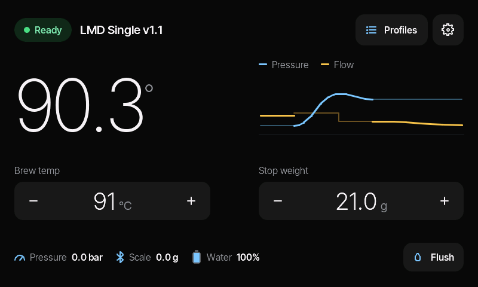
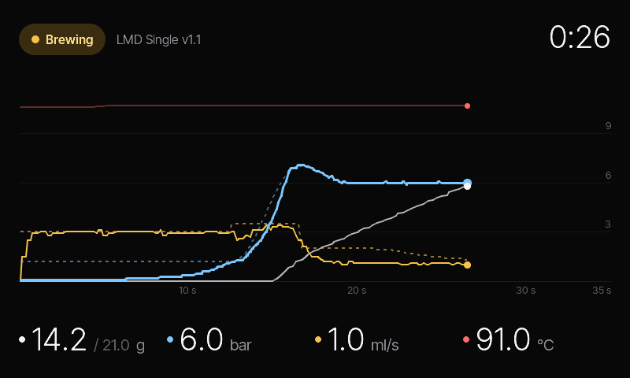
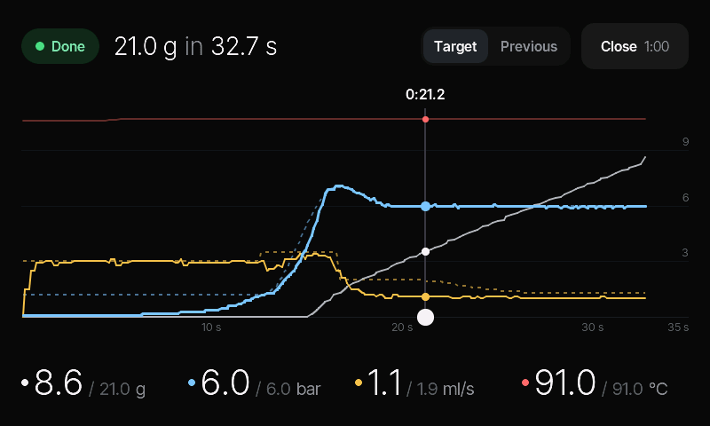

# Brewdeck

**Unofficial Wi-Fi screen for Gaggiuino machines.**

Brewdeck is a touchscreen that sits next to a [Gaggiuino](https://gaggiuino.github.io/)-modded espresso machine and
talks to it over Wi-Fi. It shows the machine at a glance, draws every shot live, lets you review it against the
profile or your previous shot, and handles the everyday controls: profile, brew temperature, stop weight, flushing.

The machine's own built-in display does not take custom firmware, so Brewdeck takes the other route: it is a separate
screen on the same network, using the machine's documented network API (REST and the WebSocket the official web UI
uses). Nothing on the machine is rewired or reflashed; the changes you make on Brewdeck (profile, brew temperature, stop
weight) are saved on the machine, as the web UI saves them.

> **Brewdeck is not an official Gaggiuino project** and is not affiliated with or endorsed by the Gaggiuino team.
> It works with Gaggiuino machines; all machine logic, safety and control stay in Gaggiuino's own firmware. Please
> report Brewdeck problems here, not to the Gaggiuino team.

<p>
  
  
  
  
</p>

## Features

A tour of every screen, with animations: **[User manual](docs/manual.md)**.

- **Ready at a glance**: boiler temperature and state (warming up, heating, ready, cooling), the active profile with a
  preview of its pressure and flow curve, pressure / scale / water status, and a warning while pressure is left in the
  system.
- **Everyday controls**: pick a profile, set brew temperature and stop weight (+/- or a keypad). Changes are saved on
  the machine, and each profile keeps its original values on the screen, so **Reset** brings them back. Before
  saving, Brewdeck checks the stored profile: if the web UI changed the other value only temporarily, Brewdeck saves
  nothing (it would save that too) and says so.
- **Live shots**: pressure, flow, weight and temperature drawn as the shot runs, with the profile's targets dashed.
- **Shot review**: scrub through the finished shot and compare it with the profile's targets or your previous shot of
  the same profile. The machine's stored shots are one tap away in **Shot history**.
- **Steam**: boiler temperature against the steam set point, with pressure, from the moment steam is switched on.
- **Flush**: tap for flush mode, hold for the machine's timed flush.
- **Machine notices**: the machine's notifications as banners and in a list; an edge glow warns before the machine
  releases pressure.
- **Standby**: a dimmed clock after a while (optionally bouncing around), and the screen switches itself off when
  it has been unused for a long time or the machine is switched off.
- **Setup on the screen**: join Wi-Fi with the on-screen keyboard; find the machine by name (mDNS) or IP. If something
  is wrong, the screen says what (Wi-Fi out of range, wrong password, machine not answering) and offers the fix.

## What Brewdeck sends to the machine

Brewdeck mostly reads. It sends only these commands, from Gaggiuino's documented REST and WebSocket APIs, and only while
the machine is idle on its home screen (to end a flush, while flushing; never during a shot, steam or hot water):

| Action on the screen | Sent to the machine |
|---|---|
| Pick a profile | `POST /api/profile-select/<id>`, then `c_save_act_prof` (makes it the boot profile) |
| Brew temperature, stop weight | `c_upd_act_prof` with only that field changed, then `c_save_act_prof` |
| Flush button | `c_opmode` FLUSH / FLUSH_AUTO / back to HOME |
| Tare (hidden by default) | `c_tare_pend` |

It never sends brewing, steam, pump, valve, heater, descaling or calibration commands, and never deletes anything.

## Hardware

> **Brewdeck needs its own screen.** Do not flash the screen fitted to your machine: on a Gaggiuino Gen 3 machine that
> screen also runs the machine's Wi-Fi, web UI and network API, which Brewdeck itself needs. Use a spare screen.

- **Screen**: a Sunton ESP32-8048S043-style 4.3" 800x480 RGB panel with an ESP32-S3 (16 MB flash, 8 MB PSRAM) and
  GT911 capacitive touch, powered over USB-C. Pins and timings are in [`firmware/include/board.h`](firmware/include/board.h).
- **Machine**: a Gaggiuino machine with its Wi-Fi web UI, on the same 2.4 GHz network as the screen. Tested with one
  machine (Gaggiuino core 8aaf6f0 on an STM32U585 board, release c929939); a Gaggiuino update can change the protocol.
  Brewdeck keeps one of the machine's three WebSocket connections open and shows up to 24 profiles.

**Tested on one screen only**: a spare Gaggiuino Gen 3 screen (the Sunton ESP32-8048S043 hardware above) that had not
yet received Gaggiuino's update [v.8aaf6f0](https://github.com/Zer0-bit/gaggiuino/releases/tag/main-8aaf6f0) (3 November
2026). That update locks the Gen 3 screen it runs on (it migrates the partitions and sets eFuses), so a screen that has
had it cannot take other firmware; that is Gaggiuino's choice for their hardware. A spare Gen 3 screen can run Brewdeck
only if it has never received that update; keep your machine itself on whatever Gaggiuino recommends. The Gen 3.5 screen
is locked too. The same Sunton model bought on its own should work (the flash script then writes it plainly, see
below), but that is untested.

**Planned**: other screens, starting with an unlocked ESP32-P4 board (Guition JC4880P443, 4.3" 480x800) bought on its
own: not the Gaggiuino Gen 3.5 screen, which uses a similar P4 board but is locked the same way.

## Building

The main build uses [pioarduino](https://github.com/pioarduino/platform-espressif32) (PlatformIO). It recompiles the
Arduino core with the `custom_sdkconfig` in [`firmware/platformio.ini`](firmware/platformio.ini) (code and data run
from PSRAM, cache line 64 B, an IRAM-safe panel interrupt), which keeps the picture steady while Wi-Fi is busy.

You need [uv](https://docs.astral.sh/uv/) (the script runs PlatformIO through `uvx --python 3.14`; pioarduino does
not support newer Python yet), git, and for flashing [esptool](https://github.com/espressif/esptool) v5
(`brew install esptool` or `pip install esptool`; esptool 4.x spells the commands `read_flash` / `write_flash`). The
first build downloads the toolchain and recompiles the core (several minutes); later builds take about 30 s. If
PlatformIO then complains that its own `pioarduino` package is too old (`6.2.0.post1` does not satisfy `>=6.2.0`), pin
it: `uv pip install --python ~/.platformio/penv/bin/python pioarduino==6.2.0`.

The build and flash script is bash (macOS, Linux); on Windows it is untested (WSL may work). The serial port is
`/dev/cu.usbserial-…` on macOS, `/dev/ttyUSB0` or similar on Linux. Always flash with `build-pio.sh --flash`, never with
`pio run -t upload` (it skips the checks below).

**1. Check the screen** (reads only, writes nothing). "Flash Encryption: Enabled" is a Gaggiuino Gen 3 screen,
"Disabled" a plain board; "Secure download mode" means it is locked and cannot take other firmware.

```sh
esptool --port /dev/cu.usbserial-XXXX get-security-info
```

**2. Back up its flash** (the whole 16 MB, from the repository root). It is the only way back to the original firmware:
keep a copy somewhere safe.

```sh
mkdir -p backup
esptool --port /dev/cu.usbserial-XXXX --baud 460800 read-flash 0 0x1000000 backup/gaggiuino-screen-backup.bin
ls -l backup/gaggiuino-screen-backup.bin    # must be exactly 16777216 bytes
```

**3. Build, then flash.**

```sh
cd firmware
./build-pio.sh ui            # first run creates include/wifi_config.h: your Wi-Fi and the machine's name or IP (optional)
./build-pio.sh ui --flash    # build and flash (env PORT=/dev/cu.usbserial-..., GAGGI_BACKUP=path to the backup)
```

`build-pio.sh --flash` asks the chip again before writing, and never guesses (a wrong choice would leave the screen
unbootable):
- **Encrypted** (a Gaggiuino Gen 3 screen): it writes with `--encrypt` and refuses to run without the 16 MB backup
  (`backup/gaggiuino-screen-backup.bin`, or wherever `GAGGI_BACKUP` points).
- **Plain** (a Sunton board bought on its own): a plain write. It also wants a backup; `NO_BACKUP=1` flashes without
  one (accepted only for a plain board).
- **Locked** (secure download mode) or no answer: it stops without writing anything.

`FLASH_ENC=encrypted` or `plain` states what you expect (the script stops if the chip disagrees); `DRY_RUN=1` shows
the decision and the esptool command without writing. If esptool cannot connect, hold BOOT, tap RST, release BOOT. The
screen restarts by itself after flashing; if the picture looks wrong, unplug and replug USB.

You can also leave `wifi_config.h` as it is: the screen then starts on "No Wi-Fi set up" and you choose the network
on the screen (it is saved there). The machine's address can be set on the screen too (Menu > Wi-Fi).

**Back to the original firmware**: check the backup's size again (a short file would leave the screen unbootable), then
write it back as it is, **without** `--encrypt` (a Gen 3 backup already holds the encrypted contents):

```sh
esptool --port /dev/cu.usbserial-XXXX --baud 460800 write-flash 0x0 backup/gaggiuino-screen-backup.bin
```

## Without hardware

Needs a C++ compiler, git and network on the first build (LVGL 9.6.0 is cloned into `sim/lvgl`), SDL2 for the
emulator (`brew install sdl2`) and Pillow for the PNG conversion (`pip install pillow`).

- **Emulator**: `sim/build-emu.sh && sim/emu` runs the real UI code in a desktop window (SDL2) against a fake machine
  that plays recorded data: a real shot and a real steam session. Mouse = finger.
  `python3 -I tools/community_profiles.py <dir>` makes a fake machine with the 24 longest-named profiles of
  Gaggiuino's community library; run it with `EMU_DATA=<dir> sim/emu` (tests long names).
- **Web demo**: `sim/web/build.sh` compiles the same UI and fake machine to WebAssembly (needs Emscripten,
  `brew install emscripten`); serve `sim/web/dist` (`python3 -m http.server -d sim/web/dist`) and open it in a browser.
- **Renders**: `sim/build.sh && sim/render sim/out && python3 sim/topng.py sim/out` draws the screens to PNG files.
- **Manual animations**: `python3 tools/gen_manual.py` re-records the GIFs and stills of the user manual from the
  emulator (after a UI change; build the emulator first, `sim/build-emu.sh`).
- **Tests**: `tests/run.sh` runs the parsers and decoders against real machine replies (`sim/data/`).

## Project layout

How the parts fit together (board, core, UI, the network tasks, the emulator): [architecture](docs/architecture.md).

| Path | What |
|---|---|
| `firmware/src/core/` | the core: `brewdeck_core.h` (the API a UI is built on), `core.cpp` (setup, loop, commands, settings), `core_state.cpp` (machine state, events), the network and machine API (`net.cpp`, `ws.cpp`, `pb.cpp`, `parse.cpp`), profile previews (`preview.cpp`), the debug web server (`shot.cpp`) |
| `firmware/src/board/` | the board layer: display, touch, backlight and memory for the Sunton ESP32-S3 panel |
| `firmware/src/ui_minimal/` | an example UI on the core API alone, to start your own from ([writing your own UI](docs/custom-ui.md)) |
| `firmware/src/ui/` | Brewdeck's UI: `ui_bridge.cpp` (the core's `bd_ui_*` entry points), screens (`screens/`, one file per screen; `ui.cpp` starts them and takes the live data; `ui_int.h` is what they share; design tokens in `theme.h`) |
| `firmware/src/shared/` | panel and touch drivers |
| `sim/` | emulator, renderer and recorded machine data |
| `tests/` | host unit tests |
| `docs/` | the [user manual](docs/manual.md) and its animations, the [architecture](docs/architecture.md), [writing your own UI](docs/custom-ui.md), the [design system](docs/design-system.md), machine API notes, the WebSocket protocol |
| `tools/` | protocol listener and extractor, manual recorder, screenshot helper, offline cup picture (`gen_cup.py`), a fake machine from the community profiles (`community_profiles.py`), font edge contrast (`font_contrast.py`) |

For development, `./build-pio.sh ui-debug` adds a small web server on the screen (`http://brewdeck.local`: screenshots
for `tools/screenshot.sh`, memory, Wi-Fi details, and remote touch). It has no password and anyone on your network can
press the screen through it, so use debug builds only for development, on a network you trust; release builds (`ui`)
leave it out.

## Contributing

Pull requests are welcome: see [CONTRIBUTING.md](CONTRIBUTING.md), especially the safety rules for anything that
talks to the machine. Security problems: please report them privately, see [SECURITY.md](SECURITY.md).

## Roadmap

Plans, not promises:

- **More screens**: an unlocked ESP32-P4 board (Guition JC4880P443, 4.3" 480x800), with a speaker for optional
  sounds ([#2](https://github.com/pongells/brewdeck/issues/2)).
- **Updates over Wi-Fi** for the screen, and later **switching between UIs** from the screen itself
  ([#3](https://github.com/pongells/brewdeck/issues/3)).
- **Your own UI in your own repository**, built against a tagged core release, with a list of UIs here
  ([#1](https://github.com/pongells/brewdeck/issues/1)).
- Maybe: an optional beeper on the current board (a small hardware addition).

## License

Brewdeck is source-available under the [PolyForm Noncommercial License 1.0.0](LICENSE): you may use, change and share
it for any noncommercial purpose (personal use, hobby projects, research, teaching, charities). Selling it, or using it
in a commercial product or service, is not allowed without the author's permission.

The example UI in [`firmware/src/ui_minimal`](firmware/src/ui_minimal) is under the [MIT License](firmware/src/ui_minimal/LICENSE),
so it can be the start of your own UI; it runs on the core, which stays under the noncommercial license.

Brewdeck contains no Gaggiuino code: it talks to the machine through Gaggiuino's documented
[REST API](https://gaggiuino.github.io/#/rest-api/rest-api) and
[WebSocket protocol](https://gaggiuino.github.io/#/rest-api/websocket), with its own decoder. The few WebSocket
fields it reads that those pages do not list are described in [docs/ws/README.md](docs/ws/README.md).

Not covered by Brewdeck's license:
- The recorded machine data in `sim/data/` (test fixtures) includes Gaggiuino profiles, among them community profiles,
  which belong to their authors and the Gaggiuino project ([CC BY-NC 4.0](https://creativecommons.org/licenses/by-nc/4.0/)).
- The fonts in `firmware/src/ui/fonts/` are generated from [Inter Tight](https://github.com/rsms/inter-tight) and stay under
  the SIL Open Font License 1.1 ([OFL.txt](firmware/src/ui/fonts/OFL.txt)).
- Libraries fetched at build time (LVGL, Arduino_GFX, the Arduino core) keep their own licenses.

## Status

A personal project, in daily use on one machine, where every screen above has been checked; the first-run setup on a
new Sunton board and the planned P4 board are untested.
