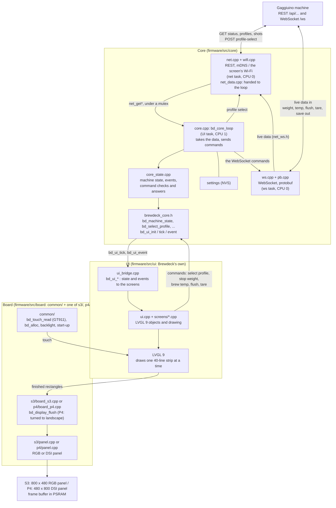
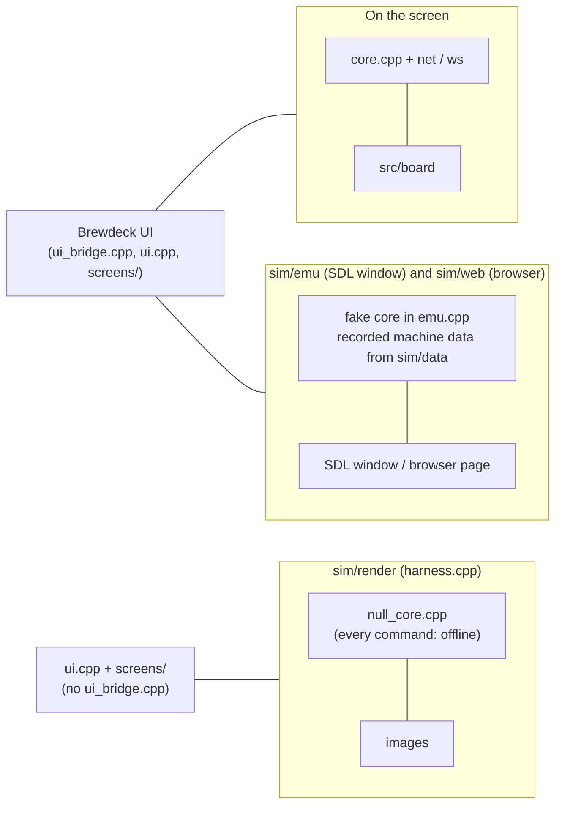
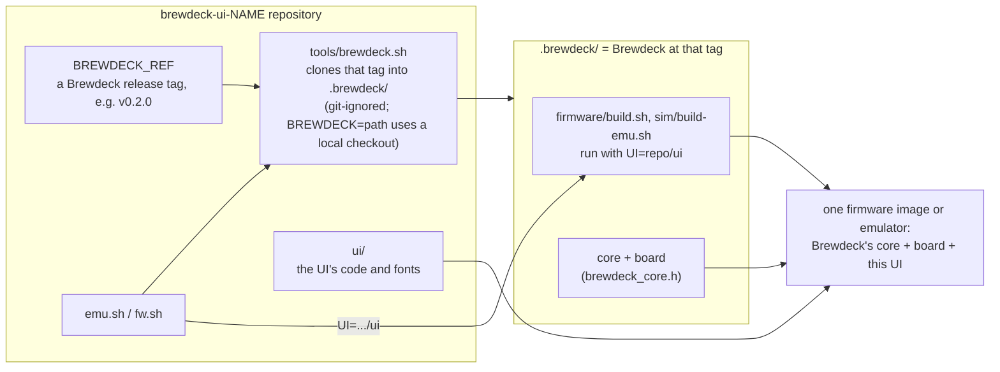

# Architecture

Brewdeck is a separate touchscreen that talks to a Gaggiuino machine over Wi-Fi, through the machine's network API
(REST and WebSocket). It is not wired to the machine. The firmware has three layers, so the same core can drive
another board or another user interface:

- **Board**: the hardware. Panel, touch, backlight, frame buffer, memory. One per screen model.
- **Core**: Wi-Fi, finding the machine, the network API, settings storage, logging. It is the only part that sends
  anything to the machine, and it checks every command before sending it.
- **UI**: the screens. Anything that implements the four `bd_ui_*` functions of
  [`brewdeck_core.h`](../firmware/src/core/brewdeck_core.h), with any graphics library (Brewdeck's own uses LVGL 9). The core builds without anything from `src/ui/`: a
  different UI replaces that folder.

## Who runs where

| Task | CPU | What |
|---|---|---|
| core (UI task, `main.cpp`) | 1 | `bd_core_loop`: takes the network tasks' data, then calls `bd_ui_tick` / `bd_ui_event`. All UI code and every `bd_*` call from the UI run here, so the UI needs no locking. |
| `net` | 0 | `net.cpp`: finding the machine (mDNS) and its REST API; `wifi.cpp`: the screen's Wi-Fi (join, roam, rejoin, the link status the UI shows). Only this task asks Wi-Fi anything: on the ESP32-P4 every Wi-Fi query is a request to its ESP32-C6 and can block. |
| `ws` | 0 | the WebSocket session: live data in, the allowed commands out |
| `update_chk` / `update_dl` | 0 | ESP32-P4: started when needed and gone after (`update.cpp`): a release check at start and once a day, a download after Install (written by `ota.cpp`; 8 KB stack in internal RAM, since it writes flash) |
| `ota_watch` | 0 | only while a new firmware is on trial (`ota.cpp`): keeps it after 60 s of running properly, else rolls back |
| `debug_http` | 0 | debug builds only (`debug_http.cpp`): screenshots, the screen recorder (frames kept in PSRAM), remote touch, memory over HTTP |

The network tasks hand data to the UI task through one mutex (`net_data.cpp` keeps what they publish; the lock is in
`net_int.h`). Big buffers (shot traces, chart data, the frame buffer) are in PSRAM; internal RAM is kept for Wi-Fi and
the draw strip.

## Commands

The UI never talks to the machine directly. A command (`bd_select_profile`, `bd_set_stop_weight`,
`bd_set_brew_temp`, `bd_flush_mode`, `bd_tare`) returns at once: either refused with a reason (a `bd_result`: offline,
busy, out of range, profile changed, ...) or queued. Each command's rules (machine online, idle in HOME, the value's
range) are in one place, `cs_cmd_*` in `core_state.cpp`, shared with the emulator. The sending task checks them again
on the newest data just before sending, and the message builders in `pb.cpp` refuse out-of-range values a third time.
The machine's answer comes back later as a `BD_EV_COMMAND` event: done once the machine reports the change, or not
taken when it did not within a few seconds. Nothing else can be sent: no pump, valve, heater, steam, descale or delete
commands exist in the API. The full list is in the README, "What Brewdeck sends to the machine".

## Without hardware

The emulator and the web demo swap the bottom two layers and keep the whole UI; the render harness drives Brewdeck's
screens directly:

The device and the emulator / web demo share `core_state.cpp`, so the fake core keeps its state, checks commands and
answers them the same way the device does. The render harness feeds the screens recorded data itself, through
`ui.cpp`'s entry points, and has no core state.

## What Brewdeck's UI uses from the core

Only the API (`brewdeck_core.h` and the LVGL 9 adapter `bd_lvgl9.h`): its screens take the API's own types
(`bd_machine`, `bd_profiles`, `bd_shot`, ...), which `ui_bridge.cpp` passes on as they are. One more header,
`preview.h`, draws the profile preview and the planned rest of a shot. It never calls the network, WebSocket or board
code directly, and takes its memory with `bd_alloc` (only the debug-build `/bench` timing uses ESP-IDF's timer).

## Writing another UI

A UI is a folder that implements `bd_ui_init`, `bd_ui_tick`, `bd_ui_event` and `bd_ui_wake` on the API in
[`brewdeck_core.h`](../firmware/src/core/brewdeck_core.h). It can live under `firmware/src/` (Brewdeck's own `ui/`, the
example `ui_minimal/`) or anywhere else: `UI=<path>` points `firmware/build.sh` and `sim/build-emu.sh` at it. The
guide, starting from the example UI: [Writing your own UI](custom-ui.md).

## UIs in their own repositories

A UI in another repository (made from the
[UI template](https://github.com/pongells/brewdeck-ui-template), like
[Ledger](https://github.com/pongells/brewdeck-ui-ledger)) holds only its own code. It depends on Brewdeck's
**source** at a pinned release, not on built files: the UI and the core are always compiled together into one image.

- **The contract** is `brewdeck_core.h` (`BD_API_VERSION` 1). Within version 1 every newer Brewdeck release keeps a
  UI compiling and working, so updating is a new tag in `BREWDECK_REF` and a rebuild. A UI declares the API version it
  was written for (`BD_UI {name, version, api}`); the core logs both at boot and warns when the UI wants a newer one.
- **Brewdeck does not know about these UIs**: nothing in this repository depends on them. Their CI builds them
  against the pinned release (the emulator and both boards).
- **How it is wired**: `firmware/build.sh` passes the folder to CMake (`BREWDECK_UI`), which compiles it with the core
  and puts the core's headers on its include path; `sim/build-emu.sh` compiles it into `sim/emu-<folder>` (a folder called
  `ui` gives `sim/emu-ui-ext`).
- **Settings**: each UI's settings are stored under its `BD_UI` name; Wi-Fi and the machine address belong to the
  core, so they survive a switch to another UI.
