# Brewdeck user manual

Brewdeck is an unofficial Wi-Fi screen for everyday brewing on Gaggiuino machines, on a headless machine or with the
built-in screen tucked away; editing profiles, settings and maintenance stay in the machine's web UI. It talks to the
machine over your Wi-Fi; nothing on the machine is rewired or reflashed (the profile, brew temperature and stop weight
you set are saved on the machine, as the web UI saves them). This manual walks through every screen. The animations are recorded from
the emulator, which runs the same screen code against a recorded shot and a recorded steam session.

- [Starting up](#starting-up)
- [The Ready screen](#the-ready-screen)
- [Brew temperature and stop weight](#brew-temperature-and-stop-weight)
- [Choosing a profile](#choosing-a-profile)
- [Pulling a shot](#pulling-a-shot)
- [Reviewing a shot](#reviewing-a-shot)
- [Steam](#steam)
- [Flushing](#flushing)
- [Machine notices and the pressure-release warning](#machine-notices-and-the-pressure-release-warning)
- [Standby: idle clock and screen off](#standby-idle-clock-and-screen-off)
- [The menu](#the-menu)
- [Wi-Fi and the machine's address](#wi-fi-and-the-machines-address)
- [When the machine is not reachable](#when-the-machine-is-not-reachable)

## Starting up

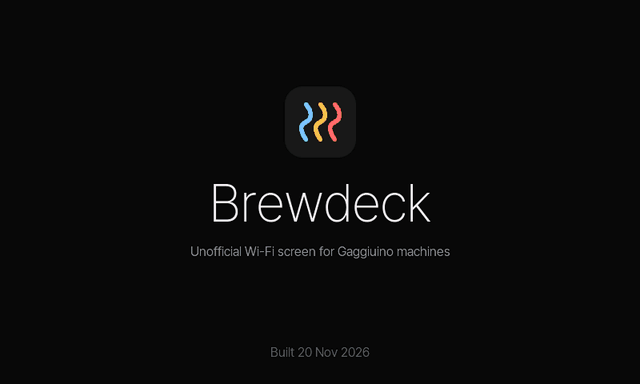

After power-on Brewdeck shows its name for 5 seconds (a tap skips it; Menu > Display > *Splash at start* turns it
off), then the Ready screen. If the machine is not reachable yet, you see what the screen is doing instead (joining
Wi-Fi, looking for the machine), see [below](#when-the-machine-is-not-reachable).

## The Ready screen

- **Top left, state**: *Warming up*, *Heating*, *Ready* (green), *Cooling* (after steam, until the boiler is back near
  the brew temperature), *Standby*, *Waiting* or *Maintenance*, as the machine reports it; while something runs,
  *Brewing*, *Steam*, *Hot water*, *Flush* or *Descale*. Next to it, the active profile's name.
- **Big number**: the boiler temperature right now.
- **Top right**: *Profiles* (choose another profile) and the settings (cog), which open the menu.
- **Profile preview**: the shape of the active profile; the key above it names the colours (blue = pressure, gold =
  flow). A bright line is what a phase drives, a dim line only a limit. Phase lengths are estimated, so the time axis is schematic.
- **Brew temp** and **Stop weight**: the active profile's values, with -/+ (see the next section).
- **Footer**: *Pressure* (turns orange while pressure is left in the system, so you know the next shot would not start
  from zero), *Scale* (Bluetooth, wired or predictive; orange *No scale* when none is connected), *Water* (an orange
  *Refill* below 20 %), and the *Flush* button.

## Brew temperature and stop weight

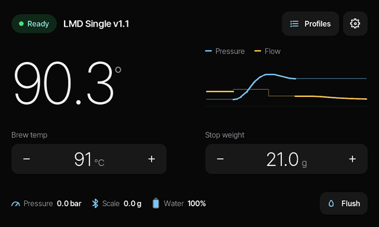

- **-/+** change the brew temperature by 1 °C (1-105 °C; type a value on the keypad to go far) and the stop weight by 0.5 g (5-80 g); hold to repeat.
- **Tap the value** to type it on a keypad. The current value is shown in grey; the first key replaces it. *Done*
  sends it, *Cancel* leaves it; the line under the value shows the allowed range, then what it was.
- A profile without a stop weight shows **∞**: the shot then ends by the profile's own rules. + gives it one
  (5 g); typing 0 on the keypad removes it again.
- A change goes to the machine 1 second after your last -/+ tap (at once from the keypad) and is **saved on the
  machine** a few seconds later, so it is still there after the machine restarts. If the machine does not take it,
  the value goes back to the machine's.
- The label then reads *Brew temp · edited* or *Stop weight · edited*: the profile differs from its original (see
  [Choosing a profile](#choosing-a-profile)). The keypad offers **Reset to …** to go back to that value.
- If the other value was changed only temporarily in the machine's web UI, Brewdeck saves nothing (it would save that
  too): your change applies until the machine restarts or another profile is picked, and a banner says *Not saved:
  profile has other unsaved changes (web UI)*.
- Changes are possible only while the machine is idle on its home screen (not during a shot, steam or a flush).

## Choosing a profile

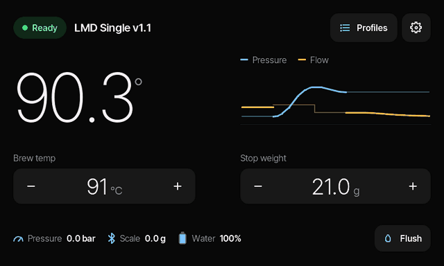

Tap *Profiles*. The list shows the active profile first, then the ones you selected most recently, then the rest by
name, one per row with its stop weight (∞ = none), brew temperature and when you last selected it (here or in the web
UI) or pulled a shot with it. Tap one to switch (only while the machine is idle; tapping the active one just closes
the list): the machine selects it, and it also becomes
the profile the machine starts with. *Community* marks profiles imported from Gaggiuino's community library. A row
shows its values once the machine has sent the profile's details. Brewdeck lists up to 24 profiles (the first 24 the
machine reports).

Brewdeck keeps each profile's **original** stop weight and brew temperature: the values it had when Brewdeck first saw
it. A value that differs from its original is shown in **blue**, with a **Restore** button on the row. Tap it (or
hold the row) to see both, then:

- **Restore original** sets the original values back and saves them on the machine (a profile that is not active is
  selected first, since the machine changes only the active profile);
- **Keep current** makes the current values the new original (for a change you meant, e.g. one made in the web UI).

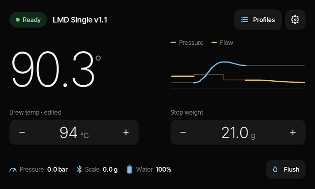

## Pulling a shot

The brewing screen opens as soon as the shot starts (brew switch on). It draws, live:

- **blue** pressure, **gold** flow, **white** weight, **red** temperature;
- **dashed** lines: what the profile asked for at each moment (target pressure or flow);
- under the chart the current values, the weight with the stop weight after it (*10.3 / 21.0 g*); top right the shot
  time.

When the shot ends (stop weight reached, or the brew switch off), the review opens 3 seconds later (or at once on a
tap).

## Reviewing a shot

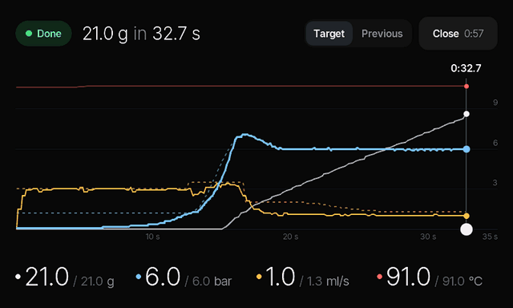

- The header shows the result (weight and time) and **Target | Previous**: the dashed lines compare the shot with the
  profile's targets (plus, dimmer, the rest of the profile it would have run after the stop), or with your previous
  shot of the same profile. *No previous* means there is no earlier shot of that profile stored.
- **Drag on the chart** to move the scrubber: the row under the chart shows the values at that moment (dashed value
  after the slash).
- **Close** returns to Ready (or to the list, for a shot opened from Shot history); after 60 seconds untouched it
  closes by itself.
- Older shots: Menu > **Shot history** lists the newest 50 shots stored on the machine; tap one to review it (only
  while the machine is online and idle; otherwise the row says *Machine offline* or *Machine busy*).

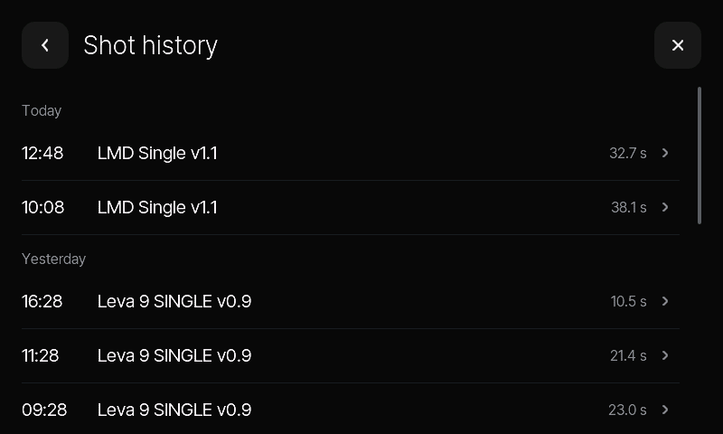

## Steam

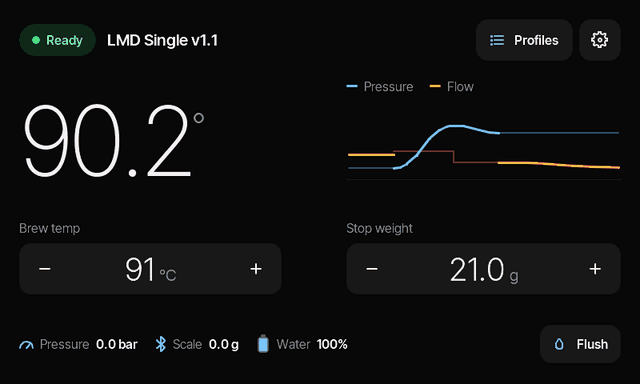

While the machine is in steam mode Brewdeck shows the boiler temperature (red) against the steam set point (dashed)
and the pressure (blue), from the moment steam was switched on; under the chart the temperature with the set point
after it (*153 / 155 °C*) and the pressure. The pressure scale grows with the pressure (up to
about 12 bar while the boiler heats with the wand closed). An orange *Refill* appears if the water runs low. After
steam, Ready shows *Cooling* until the boiler is back near the brew temperature, and the pressure stays orange until
the machine has released it.

## Flushing

- **Tap Flush**: flush mode on (the button turns blue, *Flush mode on*): the brew switch now flushes instead of
  brewing. Tap again to turn it off.
- **Hold Flush**: the button fills while you hold, then the machine runs its own timed flush (*Flushing N s*).
- Only while the machine is idle; never during a shot or steam.

## Machine notices and the pressure-release warning

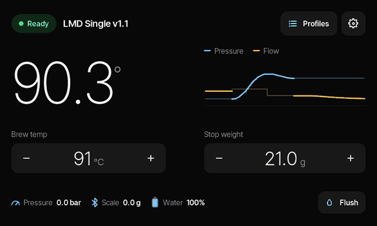

- When the machine is about to release pressure (*Dropping beats in 3 … 2 … 1*, then *Releasing pressure*), the edges
  of the screen glow blue and pulse with each beat, so you know water is coming before it does.
- Other machine messages appear for 5 seconds in place of the state pill on Ready (as a banner at the top on other
  screens). The pressure release is not kept. A **bell** then appears at the top right, next to *Profiles*, and keeps
  the last 10; a blue dot means one came in while the screen was asleep and has not been shown yet. Tap the bell to read them.
- When the machine reports a Gaggiuino update, Brewdeck shows *Update available · see web UI* once per connection
  and keeps it in Menu > About; install it in the machine's web UI.

## Standby: idle clock and screen off

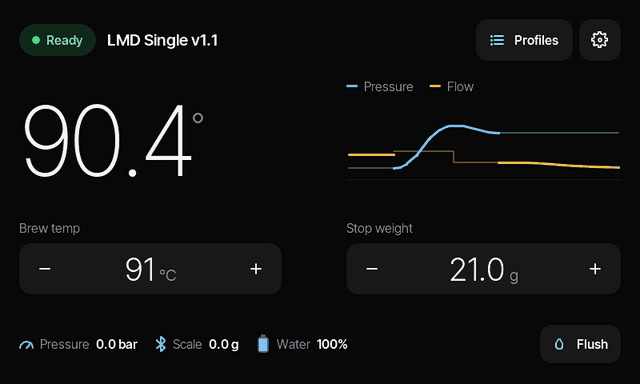

- After the *Dim after* time without a touch (10 minutes by default), Brewdeck shows a dimmed clock with the boiler
  temperature and state. Your first touch only wakes it.
- **Idle clock** in Menu > Display: *Still* (moves a few pixels every few minutes against image retention) or
  *Bouncing* (drifts around the screen and changes colour at each edge).
- After 30 minutes without a touch (or the *Dim after* time, if that is longer; never when *Dim after* is off), or when
  the "not reachable" screen has stood 2 minutes untouched (machine switched off at night), the screen switches off
  completely. It wakes on a touch, when a shot, steam or a flush starts, for a machine notice, or when the machine
  comes back (if it went off because the machine was away).
- A running shot, steam or flush counts as activity.

## The menu

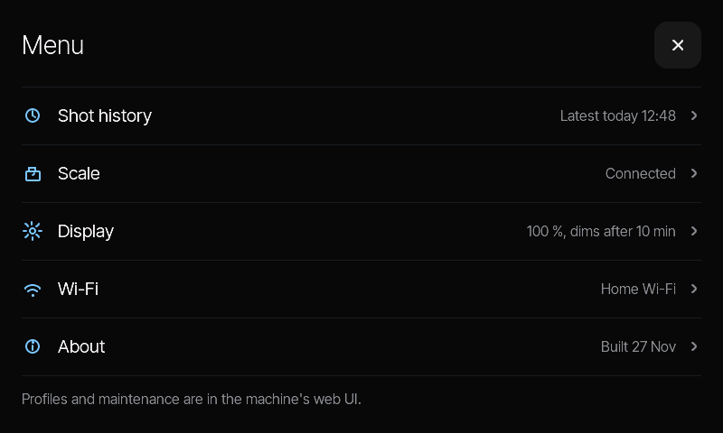

- **Shot history**: the machine's stored shots (see above).
- **Scale**: the scale's type, its connection and reading (read-only; the machine tares it at the start of a shot).
- **Display**: brightness (20-100 %), *Dim after* (off or 1-60 minutes), *Idle clock* (still or bouncing) and
  *Splash at start* (on or off). Saved on the screen.
- **Wi-Fi**: networks and the machine's address (next section).
- **About**: Brewdeck's version and build, how long it has been running and why it last started (power-on, crash,
  freeze, power dip or a system reset, e.g. after flashing a P4 board), memory, and the machine's firmware, screen and
  web UI versions, plus a pending machine update.
- **Interface** (ESP32-P4): the interfaces of the newest release, Brewdeck's own and those made by others (such as
  Ledger), each with a picture of its Ready screen and a line about it. Tap one for its details: a larger picture,
  its size and **Install** (tap, then *Tap again to install*), which replaces Brewdeck with that interface: the
  screen downloads and checks it like an update and restarts with it. Your Wi-Fi and the machine's address stay set;
  each interface keeps its own settings. To come back, use the other interface's own page if it has one, or **hold the
  screen for 5 s while it starts** (power it off and on, then keep a finger on it): it blinks once and starts the
  previous firmware.
- **Updating Brewdeck** (ESP32-P4): the screen looks for a newer Brewdeck release once a day. When there is one, the
  menu's About row says *Update available*, the notices list it once, and About shows it next to *Brewdeck version*
  with an **Install** button: tap it, then *Tap again* within 3 s. The screen downloads the release (about 15 s),
  checks that it is genuine and complete, and restarts into it; if the new version does not run properly, it goes
  back to the old one by itself. Not while a shot, steam, hot water or a flush runs. The ESP32-S3 screen is updated
  by USB (README, Installing).

Profiles and maintenance are edited in the machine's web UI.

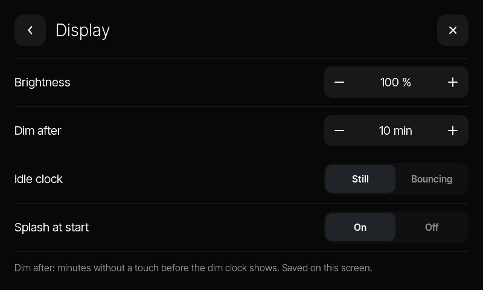 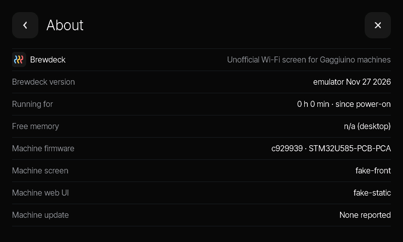

## Wi-Fi and the machine's address

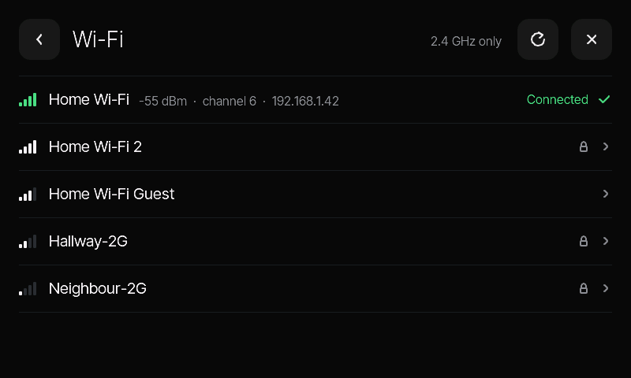

- Menu > **Wi-Fi** lists the 2.4 GHz networks around, the connected one on top. Tap a network to join it: type the
  password on the on-screen keyboard (letters, two symbol layers, shift; double-tap for caps) and tap *Join* (active
  from 8 characters). An open network joins at once. If the password is refused, the screen says so and you can try
  again. When you came from the *No Wi-Fi set up* or *Not connected* screen, the menu closes by itself once joined.
- Tap the connected network for its details: signal, access point, the screen's and the machine's address, and
  *Forget this network* (tap twice; the screen then shows *No Wi-Fi set up*).
- **Machine address**: Brewdeck finds the machine by its name (*gaggiuino.local* by default). If yours has another name
  or a fixed IP address, tap the *Machine* row on the details page (or *Machine address* on the "not found" screen),
  type the name or IP and tap *Use*.

## When the machine is not reachable

If the machine does not answer for 5 seconds, Brewdeck says what it is doing and, after 20 seconds, what is wrong (a
shorter drop goes unnoticed: Ready stays as it is):

| Screen | Means | Buttons |
|---|---|---|
| *Joining Wi-Fi* → *Not connected to Wi-Fi* | the network is out of range, the password was refused, or the network did not let the screen join (*Could not join*, e.g. a router blocking it) | while joining: Wi-Fi settings; then Try again, Wi-Fi settings (Wi-Fi settings first after a refused password) |
| *Looking for your machine* → *Machine not found* | Wi-Fi is fine, but nothing answers at the machine's name or address | none while looking; then Machine address, Wi-Fi settings |
| *No Wi-Fi set up* | no network saved yet | Choose network |

While it tries, the picture moves (steam rises from the cup, the Wi-Fi arcs light up); when something is wrong the
picture turns grey and gets a badge: an orange **?** (machine not found), an orange **!** (Wi-Fi) or a gold **+** (no
network yet). It keeps retrying in the background and goes back to Ready as soon as the machine answers. A shot or the review is
never covered by it.
